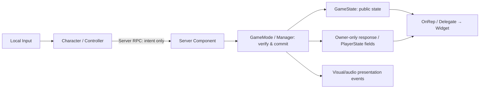

# Architecture — 클래스 구조 및 시스템 책임

> 아래 클래스·경로는 첨부 **기술 문서의 설계/구현 기록**에서 추출했다. 현재 HEAD의 실제 파일명·상속·컴포넌트 부착 여부는 Codex가 코드 검색으로 확인한다. 찾지 못했다고 유사 클래스를 바로 신규 생성하지 않는다.

## 1. 경계 원칙

- `GameMode`: 서버 전용 규칙과 최종 승인; `GameState`: 모든 클라이언트에 공개 가능한 결과와 시간.
- `PlayerState`: Pawn 교체에도 지속되는 플레이어 데이터; **필드별로 필요한 범위만 복제**.
- `PlayerController`: 소유자 입력, Client RPC 진입, 로컬 UI/카메라와 입력 모드.
- `Character`/Component: 이동·전투 요청·상호작용·애니메이션 입력·상태 효과.
- 시스템별 Manager/Director: 서버의 유물·AI·퀘스트·이벤트 원본 관리.
- `GameInstance`/Subsystem: 월드 사이의 세션·설정·결과 캐시·실패 복구; 경기 판정 수행 금지.

## 2. Framework 클래스

| 객체 | 책임 | 수명/복제 |
|---|---|---|
| `UDMGameInstance` | 결과 캐시, ServerTravel/Network/Travel 실패 복구, 방 나가기 | 월드 이동 지속, 로컬 |
| `UDMOnlineSessionSubsystem` | Steam Create/Find/Join/Destroy/Update, 비동기 타임아웃 | GameInstance Subsystem |
| `ADMFrontendPlayerController` | 메뉴 UI, 생성/참가 요청, stale 세션 정리 | 로컬/서버 역할 확인 |
| `ADMLobbyGameMode` | Host/Ready 승인, 시작 잠금, ServerTravel | 로비 서버 전용 |
| `ADMLobbyGameState` / `ADMLobbyPlayerState` | 로비 공개 설정·Ready·Host/이름 | 로비 공개 값 복제 |
| `ADMLobbyPlayerController` | 로비 UI, 소유자 Server RPC | 소유 연결 |
| `ADMMatchGameMode` | 시작 스냅샷, Phase, 사망, 승리/중단, 결과/Travel | 경기 서버 전용 |
| `UDMRespawnCoordinator` | 30초 리스폰 타이머·스폰 실패 재시도 | MatchGameMode 소유, 서버 전용 |
| `ADMMatchGameState` | Phase·종료 서버시각·공개 퀘스트/이벤트·일시 공개·최종 결과 | 필요한 공개 값 복제 |
| `ADMMatchPlayerState` | LifeState, BaseSlot, 개인 스킬/퀘스트, 경기 지속 정보 | 필드별 최소 범위 |
| `ADMMatchPlayerController` | HUD·입력·개인 응답·관전/결과 ACK | 소유 연결에만 개인 정보 전송 |
| `UDMSpectatorPresentationComponent` | 사망 카메라·Fade·관전 입력 | 소유 클라이언트 로컬 |
| `DMMatchResultRules` | 스냅샷 기반 순수 승패·순위 계산 | 서버 함수 / 월드 의존 없음 |

## 3. Character 계층

```text
ADMJellyCharacterBase
├── ADMPlayerCharacter
│   ├── UDMCombatComponent
│   ├── UDMInteractionComponent
│   └── UDMPoseComponent
└── ADMNPCCharacter
    └── ADMJellyAIController  // NPC 서버 행동

공통/관련 컴포넌트
├── UDMCharacterMovementComponent  // SavedMove·Sprint·GetMaxSpeed
├── UDMCharacterStateComponent     // ActionState·상태 효과 원본
├── UDMCharacterAudioComponent     // 발소리 파이프라인
├── UDMJellyAnimInstance / ABP_DMJelly  // 로컬 관성 본 변형
└── UDMJellyPhysicsComponent       // 실제 사망 시 Ragdoll
```

상속과 부착 개수는 실제 `.h`·생성자를 검증해야 한다. NPC가 Combat/Interaction/Pose를 플레이어와 같은 방식으로 갖는다고 가정하지 않는다. PlayerState의 스킬 컴포넌트는 Pawn 생존과 무관하게 지속된다.

## 4. 서버 시스템 및 원본

| 원본 | 책임 | 읽는 쪽 / 주의 |
|---|---|---|
| `ADMRelic::WorldState`, `RegisteredBaseSlot` | 개별 유물 상태 | `ADMRelicManager`가 예약·운반·등록 Commit 및 등록 수 계산 |
| `ADMRelicManager` | 초기 배치, 운반자 관계, 예약, 등록 수 조회 | 상자/GameState에 등록 수 캐시 중복 금지 |
| `ADMRelicChest`, `ADMBaseZone`, `ADMRelicSpawnPoint` | 상자 진입점, 진영 활성, 유물 배치·복구 | 소유·판정은 Manager |
| `UDMQuestDirector` | 공통 퀘스트 타이밍·마감·선정 | 개인 진행 원본은 PlayerState 소유 `UDMQuestProgressComponent` |
| `UDMRandomEventDirector` | 정전·패닉·입력 반전의 일정·배제·종료 | 시각적 정전은 `ADMBlackoutController` 등 로컬 표현 |
| `UDMNPCPopulationDirector` | NPC 목표 수, 스폰/회수, 군집 반응 | 개별 행동은 `ADMJellyAIController` |
| `UDMSkillComponent` | 사용 검증·대상 선정·쿨다운 종료 시각 | MatchPlayerState 소유, 사용자별 동기화 |
| `UDMCharacterStateComponent` | 스턴/투명 상태 태그, ActionState | 관찰자용 bool은 판정 원본이 아님 |
| `UDMVoiceChatSubsystem` | Steam Voice, Talker, 수신·송신·PTT 정책 | 로컬 독립 정보, 서버 승패와 분리 |
| `UDMLocalSettingsSubsystem` | 볼륨·감도 SaveGame | 로컬 전용 |

## 5. 상태 축 및 저장 위치

| 상태/데이터 | 원본 또는 확정 권한 | 외부 전달 방식 |
|---|---|---|
| Match Phase, 시작 인원, 규칙 스냅샷 | GameMode 결정 → GameState 저장 | 공개 RepNotify |
| MatchResult/ResultId | GameMode만 확정, GameState 결과 보관 | 결과 RepNotify, 소유자 캐시 후 ACK |
| LifeState·BaseSlot | 서버 PlayerState | 소유자에 필요한 정보만(공개가 필요한 관찰자 표현은 별도) |
| ActionState·Status Tags | CharacterStateComponent | 비공개 원본 / 필요한 표현 bool |
| 이동·Sprint·Jump | CharacterMovement | 이동 예측/보정·속도 관찰 |
| 공격·방어 쿨다운 | CombatComponent | 소유자의 진행 표시 |
| 개별 유물 상태·운반자 | Relic + RelicManager | 숨겨진 소유관계·신원 노출 금지 |
| 유물 등록 수 | RelicManager가 유물 상태에서 계산 | 상자 응답과 제한 시점의 공개만 |
| 스킬 쿨다운 | SkillComponent | EndServerTime owner only |
| 관전 카메라/젤리 스프링/로컬 설정 | 클라이언트 로컬 | 복제하지 않음 |

## 6. 데이터 흐름



서로 다른 Actor의 RPC·Replication 도착 순서를 사실상 동기화라고 가정하지 않는다. ResultId, RequestId, 서버 종료 시각을 이용해 인과관계를 명시한다. Listen Server 호스트는 서버 측 값 변경 후 별도로 UI 알림이 필요하며 `OnRep`만 믿지 않는다.

## 7. 수명 경계

| 사건 | 정리 의무 |
|---|---|
| Pawn 교체 | 이전 Pawn Delegate 해제, 입력 Mapping·HUD 재연결 |
| 사망 | 상호작용 세션·예약 해제, 운반 유물 드롭, Sprint/스킬·전투 동작 정리 |
| 리스폰 | 새 Pawn Spawn/Possess 성공 후 LifeState Alive 및 클라이언트 Handoff |
| Phase 종료·중단 | 퀘스트·이벤트 타이머, 공개 데이터, 공격·스킬 Commit 차단 |
| 로비↔경기 Travel | GameRoot/입력 상태, Result 캐시/ACK, 네트워크·세션 정리 |
| Steam Voice 모드 변경·종료 | Talker/로컬 음소거/타이머 정리, 사망 청취 전환 |

## 8. 코드 검색 출발점(존재 여부 확인 필요)

- `Source/DontMelt/Private/Framework/Match/DMMatchGameMode.cpp` — `TryFinishMatch`, `EvaluateMatchResult`, `TryCommitPlayerDeath`
- `Source/DontMelt/Private/Framework/Match/DMMatchGameState.cpp` — `GetLifetimeReplicatedProps`
- `Source/DontMelt/Private/Relic/DMRelicManager.cpp` — `TryCommitRelicDeposit`
- `Source/DontMelt/Private/Characters/Components/DMInteractionComponent.cpp` — `ServerRequestInteraction_Implementation`
- `Source/DontMelt/Private/Skills/DMSkillComponent.cpp` — `ResolveSkillTarget`
- `Source/DontMelt/Private/AI/DMNPCPopulationDirector.cpp` — `InitializePopulation`
- `Source/DontMelt/Private/UI/DMGameRootWidget.cpp` — `NativeConstruct`
- `Source/DontMelt/Private/Voice/DMVoiceChatSubsystem.cpp` — `RefreshRemoteTalkerPolicy`

## 9. 근거 문서

[아키텍처 원본](../Docs/Design/SystemArchitecture.md) · [기술 아키텍처](../Docs/Technical/01_Architecture.md) · [Replication/RPC](../Docs/Technical/04_Replication_RPC.md) · [책임 분리 기록](../Docs/Refactoring/01_Match_Responsibility_Split.md)
