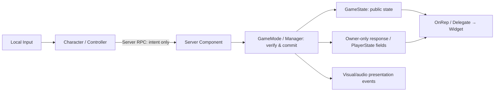

# Architecture — 클래스 구조 및 시스템 책임

## P3-9 최신 기준 — 2026-11-17

기준 HEAD: `001a08241ecd01dfa1ef565f11c7791eaf73eaeb`. [최신 구현 대조와 검증 한계](ImplementationStatus.md#p3-9--최신-아키텍처-결정-및-구현-대조-2026-11-17)를 함께 읽는다. 아래 최신 절과 충돌하는 P2/기존 본문은 당시 설계·조사 이력으로 보존하며 현재 완료 근거로 사용하지 않는다.

- **최신 결정:** `ADMJellyCharacterBase`를 공통 기반으로 `ADMPlayerCharacter`·`ADMNPCCharacter`를 유지한다. 기존 GameMode·GameState·PlayerState·PlayerController 및 Manager·Component 책임을 유지한다. 두 Character 헤더의 실제 상속도 확인했다.
- **B안 통합 중단:** P3-7 Anonymous Presentation PoC를 본 프로젝트에 통합하지 않는다. 실험 브랜치·Worktree는 별도 보존하며 코드·에셋을 복사하지 않는다.
- 정상 게임 화면의 플레이어/NPC 위장 일관성은 유지한다. 네트워크 메타데이터(클래스·소유 관계 등) 수준의 플레이어 정체 은폐는 필수 요구사항에서 제외한다. 이는 유물 운반 관계·개인 상태 등 비공개 게임 데이터의 전역 공개 허용이 아니다.
- Server Authority / Single Source of Truth / Least Replication / Event Driven을 유지한다. P3-1 결과 표시·순위, P3-2 HUD, P3-3 시작 게이트, P3-4 로비 복구는 기존 책임 안의 변경이다.
- 도착 제한 최신 C++ 기본값은 **90초**다. 아래 P2의 120초 및 구현 전 표현은 당시 기록이다.

## P2 승인 동기화 — 2026-11-13 (당시 기록; 최신 기준은 상단 P3-9)

이번 사용자 P2 요청의 명시 범위만 **설계 승인**으로 채택한다. 과거 승인으로 소급하지 않는다. 기준 HEAD는 `914173a`이며 구현 사실·설계 승인·에셋 적용·실행 검증은 별개다. 상세 근거와 미결정 사항은 [ImplementationStatus 10절](ImplementationStatus.md#10-p2-승인-설계-및-현재-구현--2026-11-13)을 따른다.

**아래 기존 본문과의 관계:** 이 절 뒤의 기존 본문은 삭제하지 않고 이전 설계·조사 기록으로 보존한다. E1~E10과 충돌하는 값·완료/승인/미확인 표현은 이 절과 중앙10절이 대체한다. 특히90초·Walk300·NPC×10/40·NPC 발소리·3요소 이벤트 HUD·타임아웃 즉시 재요청은 최신 목표가 아니다. E1~E10 밖의 항목을 이번 승인으로 일괄 확정하지 않는다.

### E1 — 결과 통계와 순위 분리

**설계 승인:** 결과표 유물 열은 경기 중 누적 획득 횟수, 최종 순위는 종료 시 등록 유물 수를 사용하며 동률 공동 순위를 허용한다. 두 통계를 별도 관리하고 표시 변경으로 서버 승리 판정을 바꾸지 않는다.

**구현 확인 / 부분 구현:** `ADMRelicManager::TryCommitRelicAcquisition` → `ADMMatchPlayerState::IncrementAcquiredRelicCount` → `ADMMatchGameMode::BuildFinalPlayerResults`로 누적 통계를 보관한다. `FDMMatchResultEntry`의 `AcquiredRelicCount`와 `RelicCount`가 분리되어 있다. 그러나 `UDMPlayerResultRowWidget::SetResultEntry`는 현재 `RelicCount`를 표시하므로 목표 표시와 불일치한다. 성공 Pickup/Steal Commit마다 증가하는 것이 현재 동작이다.

책임·서버/Client 흐름·RPC/복제·UI·변경 예상 범위·미결정·검증 시나리오는 [중앙 기능 명세](ImplementationStatus.md)의 E1 절을 함께 읽는다.

### E3 — 참가자 도착 대기 120초

**설계 승인:** 기본 도착 제한은120초다. 경기 맵 서버 GameMode가 승인 참가자의 준비와 시스템 초기화를 검증한다. PC 존재만으로 완료하지 않는다. 도착 제한과 튜토리얼 제한을 분리하고 무한 대기를 방지한다. 미도착·명시적 이탈·Spawn/Possess 실패는 가능한 범위에서 진단·사용자 안내를 구분한다.

**구현 확인:** `ADMMatchGameMode::StartPlay`가 아직 명단이 확정되지 않은 Waiting에서 타이머를 설정한다. 클라이언트 로딩 시작 시점 기준이 아니다. `HandleStartingNewPlayer_Implementation`은 부모 Spawn/Possess 후 Pawn/Controller를 확인한다. `IsStartingRosterComplete`는 기대 인원, 유효 PlayerState, 유효·고유 BaseSlot, Alive, Pawn·Controller·PlayerState 연결을 확인한다. `TryFinalizeStartingRoster`는 스폰 지점 및 NPC/유물/퀘스트/이벤트 초기화 후 도착 타이머를 해제하고 튜토리얼 게이트로 이동한다.

책임·서버/Client 흐름·RPC/복제·UI·변경 예상 범위·미결정·검증 시나리오는 [중앙 기능 명세](ImplementationStatus.md)의 E3 절을 함께 읽는다.

### E8 — Steam 안전 복구 상태 머신 유지

**설계 승인:** 기존 상태 머신을 유지하며 전면 재작성하지 않는다. Create/Find/Join/Destroy/Update별 비동기 결과를 구분하고 기본 요청30초를 유지한다. 타임아웃은 플랫폼 취소 완료가 아니다. 작업 중 중복 요청을 거절하고 원 요청 완료·필요한 잔여 세션 정리·안전한 재시도 조건 확인 후 다음 요청을 허용한다. 불확실하면 차단·재시작 안내한다. 영구 차단 후 무의미한 로비 재시도를 반복하지 않는다.

**구현 확인:** `UDMOnlineSessionSubsystem::HandleOperationTimeout`은 지연 완료를 기다리고 Find 취소를 시도한다. Create/Join 지연·실패는 `BeginRecoveryDestroy`로 잔여 세션을 처리한다. Destroy 완료는 성공 플래그와 NamedSession 잔존을 확인한다. Find는 취소/완료 결과에 따라 종료하며 Update 지연 완료는 실패 처리한다. `CompleteOperation`은 Delegate·Timer·상태를 정리한 뒤 원 작업 결과를 알린다. `FailClosedRecovery`의 bRecoveryBlocked와 `RejectBlockedOperation`은 불확실한 상태에서 새 요청을 막는다.

책임·서버/Client 흐름·RPC/복제·UI·변경 예상 범위·미결정·검증 시나리오는 [중앙 기능 명세](ImplementationStatus.md)의 E8 절을 함께 읽는다.

### E9-A — 전원 튜토리얼과 300초 제한

**설계 승인:** 경기 시작 전 전원 완료, 기존300초 제한, 완료·실패·시간 초과·이탈 구분, 서버 최종 판정을 채택한다.

**구현 확인:** `ADMMatchGameMode::StartPreMatchTutorialGate`는 확정 명단을 기준으로 완료 집합·300초 타이머·Client 튜토리얼 표시를 관리하고 완료 후 Countdown으로 진행한다. 표시 실패·시간 초과는 현재 내부 실패 중단 경로다. 도착120초 타이머와 별도다.

책임·서버/Client 흐름·RPC/복제·UI·변경 예상 범위·미결정·검증 시나리오는 [중앙 기능 명세](ImplementationStatus.md)의 E9-A 절을 함께 읽는다.

### E9-B — 서버 리스폰 재시도 상한

**설계 승인:** 최초 실패 후 최대3회 재시도, 서버 관리, 무한 재시도 방지, 성공 시 Pawn·Controller·PlayerState 연결 복구, 실패 원인·소진 기록을 유지한다.

**구현 확인:** `UDMRespawnCoordinator::HandleRespawnTimerExpired` / `ScheduleRespawnRetry`가 재시도와 연결·보호 적용을 관리한다. 기본 재시도 간격은 GameMode의1초이며 최소0.05초 보정이 있다. 최대3회 소진 시 현재 코드는 전체 경기 내부 실패 중단을 요청한다.

책임·서버/Client 흐름·RPC/복제·UI·변경 예상 범위·미결정·검증 시나리오는 [중앙 기능 명세](ImplementationStatus.md)의 E9-B 절을 함께 읽는다.

### E9-C — 플레이어 실제 사망에 대한 NPC 비웃음

**설계 승인:** 실제 플레이어 사망 후 주변 NPC 반응과 비웃음 표현을 유지한다. Panic/Stun·행동 상태 충돌을 막고 다른 참가자에게 제공하는 사망 위치·상황 단서를 고려한다. 단순한 장식 효과로 취급하지 않는다.

**구현 확인:** GameMode 사망 처리 → `UDMNPCPopulationDirector::HandleNearbyPlayerDeath` → `ADMJellyAIController::TryStartDeathMockingReaction`의 행동 전환·이동 중지·Laugh 요청 경로가 있다. 규칙 DataAsset C++ 기본값은 반경800cm, 최대3명, 지속2.5초다. 이는 현재 구현 기준값이며 실제 에셋 적용 수치와 재생 성공을 의미하지 않는다.

책임·서버/Client 흐름·RPC/복제·UI·변경 예상 범위·미결정·검증 시나리오는 [중앙 기능 명세](ImplementationStatus.md)의 E9-C 절을 함께 읽는다.

### E10 — 정보 공개 범주와 Listen Host 신뢰 경계

**설계 승인:** Server Authority·최소 전송·OwnerOnly를 유지한다. 전체 Client 공개 / Owner Client 전용 / 스킬 시전자 전용 / 관전자 예외 / 서버 전용으로 구분한다. 판정 원본과 표현 데이터를 분리한다. UI 비표시를 비전송 보장으로 취급하지 않는다. Listen Host는 권위 서버를 실행하는 신뢰 서버다. Host에게 서버 원본까지 은폐한다고 보장하지 않는다.

| 범주 | 목표 계약 | 현재 코드 관측 / 승인 경계 |
|---|---|---|
| 전체 Client 공개 | 공개 경기 상태·필요한 관찰 표현만 | GameState Phase·공개 이벤트/퀘스트·최종 결과, PlayerState rematch ready, Character Action/스턴·투명 표현. Relevant 범위와 필드별 재검수 필요 |
| Owner 전용 | 개인 상태·개인 응답 최소화 | MatchPlayerState LifeState/BaseSlot/운반 여부, CharacterState 상세 태그·투명화 시간은 OwnerOnly |
| 시전자 전용 | 기능에 필요한 최소 정보의 예외 명세 | ClientSetFootstepAmplifyPresentation은 대상 PlayerState를 전달. 현재 전달 사실이며 해당 참조 전체의 최종 예외 승인은 시스템 명세 확인 필요 |
| 관전자 예외 | 관전 정책상 필요한 범위만 | ClientBeginSpectatorSequence의 Context·KillerPawn 등은 현재 구현. 숨길 정보와 예외 범위를 별도 확인 |
| 서버 전용 | 원본 판정·불필요한 신원/운반 관계 | RelicManager 비복제, 스킬 서버 대상 선정. 클라이언트가 대상 Actor 대신 선택 정책을 제출 |

책임·서버/Client 흐름·RPC/복제·UI·변경 예상 범위·미결정·검증 시나리오는 [중앙 기능 명세](ImplementationStatus.md)의 E10 절을 함께 읽는다.

**검증 상태:** BP/DataAsset/Animation 실제 적용은 에셋 미검증, 빌드·PIE·Steam은 실행 미검증이다. 아래 완료 기준은 향후 검증 시나리오이며 통과 기록이 아니다. C++·WBP·Config 변경은 이번 문서 승인에 포함되지 않는다. [공통 게임 규칙](GameplayRules.md) · [네트워크 정책](NetworkPolicy.md)를 상호 참조한다.

---

> 아래 클래스·경로는 첨부 **기술 문서의 설계/구현 기록**에서 추출했다. 현재 HEAD의 실제 파일명·상속·컴포넌트 부착 여부는 Codex가 코드 검색으로 확인한다. 찾지 못했다고 유사 클래스를 바로 신규 생성하지 않는다.

## 1. 경계 원칙

- `GameMode`: 서버 전용 규칙과 최종 승인; `GameState`: 모든 클라이언트에 공개 가능한 결과와 시간.
- `PlayerState`: Pawn 교체에도 지속되는 플레이어 데이터; **필드별로 필요한 범위만 복제**.
- `PlayerController`: 소유자 입력, Client RPC 진입, 로컬 UI/카메라와 입력 모드.
- `Character`/Component: 이동·전투 요청·상호작용·애니메이션 입력·상태 효과.
- 시스템별 Manager/Director: 서버의 유물·AI·퀘스트·이벤트 원본 관리.
- `GameInstance`/Subsystem: 월드 사이의 세션·설정·결과 캐시·실패 복구; 경기 판정 수행 금지.

## 2. Framework 클래스

| 객체 | 책임 | 수명/복제 |
|---|---|---|
| `UDMGameInstance` | 결과 캐시, ServerTravel/Network/Travel 실패 복구, 방 나가기 | 월드 이동 지속, 로컬 |
| `UDMOnlineSessionSubsystem` | Steam Create/Find/Join/Destroy/Update, 비동기 타임아웃 | GameInstance Subsystem |
| `ADMFrontendPlayerController` | 메뉴 UI, 생성/참가 요청, stale 세션 정리 | 로컬/서버 역할 확인 |
| `ADMLobbyGameMode` | Host/Ready 승인, 시작 잠금, ServerTravel | 로비 서버 전용 |
| `ADMLobbyGameState` / `ADMLobbyPlayerState` | 로비 공개 설정·Ready·Host/이름 | 로비 공개 값 복제 |
| `ADMLobbyPlayerController` | 로비 UI, 소유자 Server RPC | 소유 연결 |
| `ADMMatchGameMode` | 시작 스냅샷, Phase, 사망, 승리/중단, 결과/Travel | 경기 서버 전용 |
| `UDMRespawnCoordinator` | 30초 리스폰 타이머·스폰 실패 재시도 | MatchGameMode 소유, 서버 전용 |
| `ADMMatchGameState` | Phase·종료 서버시각·공개 퀘스트/이벤트·일시 공개·최종 결과 | 필요한 공개 값 복제 |
| `ADMMatchPlayerState` | LifeState, BaseSlot, 개인 스킬/퀘스트, 경기 지속 정보 | 필드별 최소 범위 |
| `ADMMatchPlayerController` | HUD·입력·개인 응답·관전/결과 ACK | 소유 연결에만 개인 정보 전송 |
| `UDMSpectatorPresentationComponent` | 사망 카메라·Fade·관전 입력 | 소유 클라이언트 로컬 |
| `DMMatchResultRules` | 스냅샷 기반 순수 승패·순위 계산 | 서버 함수 / 월드 의존 없음 |

## 3. Character 계층

```text
ADMJellyCharacterBase
├── ADMPlayerCharacter
│   ├── UDMCombatComponent
│   ├── UDMInteractionComponent
│   └── UDMPoseComponent
└── ADMNPCCharacter
    └── ADMJellyAIController  // NPC 서버 행동

공통/관련 컴포넌트
├── UDMCharacterMovementComponent  // SavedMove·Sprint·GetMaxSpeed
├── UDMCharacterStateComponent     // ActionState·상태 효과 원본
├── UDMCharacterAudioComponent     // 발소리 파이프라인
├── UDMJellyAnimInstance / ABP_DMJelly  // 로컬 관성 본 변형
└── UDMJellyPhysicsComponent       // 실제 사망 시 Ragdoll
```

상속과 부착 개수는 실제 `.h`·생성자를 검증해야 한다. NPC가 Combat/Interaction/Pose를 플레이어와 같은 방식으로 갖는다고 가정하지 않는다. PlayerState의 스킬 컴포넌트는 Pawn 생존과 무관하게 지속된다.

## 4. 서버 시스템 및 원본

| 원본 | 책임 | 읽는 쪽 / 주의 |
|---|---|---|
| `ADMRelic::WorldState`, `RegisteredBaseSlot` | 개별 유물 상태 | `ADMRelicManager`가 예약·운반·등록 Commit 및 등록 수 계산 |
| `ADMRelicManager` | 초기 배치, 운반자 관계, 예약, 등록 수 조회 | 상자/GameState에 등록 수 캐시 중복 금지 |
| `ADMRelicChest`, `ADMBaseZone`, `ADMRelicSpawnPoint` | 상자 진입점, 진영 활성, 유물 배치·복구 | 소유·판정은 Manager |
| `UDMQuestDirector` | 공통 퀘스트 타이밍·마감·선정 | 개인 진행 원본은 PlayerState 소유 `UDMQuestProgressComponent` |
| `UDMRandomEventDirector` | 정전·패닉·입력 반전의 일정·배제·종료 | 시각적 정전은 `ADMBlackoutController` 등 로컬 표현 |
| `UDMNPCPopulationDirector` | NPC 목표 수, 스폰/회수, 군집 반응 | 개별 행동은 `ADMJellyAIController` |
| `UDMSkillComponent` | 사용 검증·대상 선정·쿨다운 종료 시각 | MatchPlayerState 소유, 사용자별 동기화 |
| `UDMCharacterStateComponent` | 스턴/투명 상태 태그, ActionState | 관찰자용 bool은 판정 원본이 아님 |
| `UDMVoiceChatSubsystem` | Steam Voice, Talker, 수신·송신·PTT 정책 | 로컬 독립 정보, 서버 승패와 분리 |
| `UDMLocalSettingsSubsystem` | 볼륨·감도 SaveGame | 로컬 전용 |

## 5. 상태 축 및 저장 위치

| 상태/데이터 | 원본 또는 확정 권한 | 외부 전달 방식 |
|---|---|---|
| Match Phase, 시작 인원, 규칙 스냅샷 | GameMode 결정 → GameState 저장 | 공개 RepNotify |
| MatchResult/ResultId | GameMode만 확정, GameState 결과 보관 | 결과 RepNotify, 소유자 캐시 후 ACK |
| LifeState·BaseSlot | 서버 PlayerState | 소유자에 필요한 정보만(공개가 필요한 관찰자 표현은 별도) |
| ActionState·Status Tags | CharacterStateComponent | 비공개 원본 / 필요한 표현 bool |
| 이동·Sprint·Jump | CharacterMovement | 이동 예측/보정·속도 관찰 |
| 공격·방어 쿨다운 | CombatComponent | 소유자의 진행 표시 |
| 개별 유물 상태·운반자 | Relic + RelicManager | 숨겨진 소유관계·신원 노출 금지 |
| 유물 등록 수 | RelicManager가 유물 상태에서 계산 | 상자 응답과 제한 시점의 공개만 |
| 스킬 쿨다운 | SkillComponent | EndServerTime owner only |
| 관전 카메라/젤리 스프링/로컬 설정 | 클라이언트 로컬 | 복제하지 않음 |

## 6. 데이터 흐름



서로 다른 Actor의 RPC·Replication 도착 순서를 사실상 동기화라고 가정하지 않는다. ResultId, RequestId, 서버 종료 시각을 이용해 인과관계를 명시한다. Listen Server 호스트는 서버 측 값 변경 후 별도로 UI 알림이 필요하며 `OnRep`만 믿지 않는다.

## 7. 수명 경계

| 사건 | 정리 의무 |
|---|---|
| Pawn 교체 | 이전 Pawn Delegate 해제, 입력 Mapping·HUD 재연결 |
| 사망 | 상호작용 세션·예약 해제, 운반 유물 드롭, Sprint/스킬·전투 동작 정리 |
| 리스폰 | 새 Pawn Spawn/Possess 성공 후 LifeState Alive 및 클라이언트 Handoff |
| Phase 종료·중단 | 퀘스트·이벤트 타이머, 공개 데이터, 공격·스킬 Commit 차단 |
| 로비↔경기 Travel | GameRoot/입력 상태, Result 캐시/ACK, 네트워크·세션 정리 |
| Steam Voice 모드 변경·종료 | Talker/로컬 음소거/타이머 정리, 사망 청취 전환 |

## 8. 코드 검색 출발점(존재 여부 확인 필요)

- `Source/DontMelt/Private/Framework/Match/DMMatchGameMode.cpp` — `TryFinishMatch`, `EvaluateMatchResult`, `TryCommitPlayerDeath`
- `Source/DontMelt/Private/Framework/Match/DMMatchGameState.cpp` — `GetLifetimeReplicatedProps`
- `Source/DontMelt/Private/Relic/DMRelicManager.cpp` — `TryCommitRelicDeposit`
- `Source/DontMelt/Private/Characters/Components/DMInteractionComponent.cpp` — `ServerRequestInteraction_Implementation`
- `Source/DontMelt/Private/Skills/DMSkillComponent.cpp` — `ResolveSkillTarget`
- `Source/DontMelt/Private/AI/DMNPCPopulationDirector.cpp` — `InitializePopulation`
- `Source/DontMelt/Private/UI/DMGameRootWidget.cpp` — `NativeConstruct`
- `Source/DontMelt/Private/Voice/DMVoiceChatSubsystem.cpp` — `RefreshRemoteTalkerPolicy`

## 9. 근거 문서

[아키텍처 원본](../Docs/Design/SystemArchitecture.md) · [기술 아키텍처](../Docs/Technical/01_Architecture.md) · [Replication/RPC](../Docs/Technical/04_Replication_RPC.md) · [책임 분리 기록](../Docs/Refactoring/01_Match_Responsibility_Split.md)
