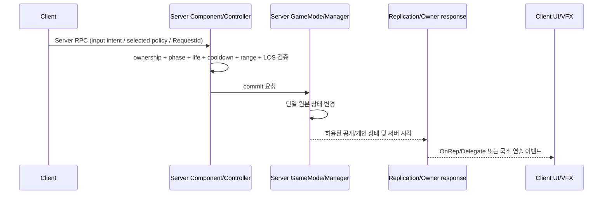

# NetworkPolicy — 서버 권한 및 네트워크 정책

## 1. 최상위 불변 조건

1. **Server Authority:** 승패, Phase, 사망/리스폰, 공격 Hit, NPC 반응, 유물 예약/소유권/등록, 스킬 대상/효과/쿨다운, 퀘스트·이벤트 조건은 서버만 확정.
2. **Single Source of Truth:** 값을 읽기 위한 중복 상태를 다른 Actor에 상시 저장하지 않는다. 복제본은 **표현/캐시**임을 명시한다.
3. **Least Replication:** 소유자에게만 필요한 데이터는 OwnerOnly / owner Client RPC 등으로 제한. 숨길 정보를 GameState에 올리고 HUD에서만 숨기는 것은 금지.
4. **Event Driven:** RepNotify, Delegate, Timer, 성공 Commit 이벤트 중심. 연속적으로 변하는 클라이언트 UI는 복제된 `EndServerTime`과 서버 시간 차이로 계산.
5. **비동기 내결함성:** RPC/복제/Travel이 서로 다른 Actor에서 도착할 순서를 가정하지 않음; RequestId, AttackSequence, ResultId로 멱등성·중복 처리.

## 2. 요청/검증/확정/표현 계약

클라이언트가 최종 `HitResult`, 피해 대상 PlayerState, 승리 판정, 유물 소유자 변경, 스킬 목표 Actor를 제출하게 하지 않는다. 입력은 **의도와 선택 정책**만 보낸다. 서버의 검증 실패는 비공개 상태를 설명하지 않는 일반 거절로 반환한다.

## 3. 데이터 배포 매트릭스

| 데이터 | 서버 원본 | 전송 | 유의사항 |
|---|---|---|---|
| Phase, 종료 서버 시각, 공개 이벤트/퀘스트, 최종 결과 | MatchGameMode→MatchGameState | **모든 클라이언트** | 허용된 공개 내용만 |
| 시작 인원/유물 목표 등 공개 규칙 | MatchGameState | **모든 클라이언트** | 스냅샷 고정 |
| 소유자의 스킬 쿨다운·개인 퀘스트 진행 | MatchPlayerState 컴포넌트 | **OwnerOnly** | 원본 전체가 다른 플레이어에게 가지 않는지 확인 |
| 상자 안 등록 수 | RelicManager 조회 | **상자를 연 해당 소유 연결** | 패널 닫기·거리 이탈 시 UI 스냅샷 폐기 |
| 캐릭터 위치·관찰 가능한 움직임 | CharacterMovement / 관찰 표현 | 필요한 Relevant 연결 | 보이는 행동만 |
| 스턴·투명 상태의 관찰자 표현 | CharacterState에서 파생 | 최소 표현 bool RepNotify | **게임 판정에는 사용 금지** |
| 유물 위치 일시 공개 | 서버가 유효 시간에 생성 | 허용 시간의 전 클라이언트 | 공개 종료 후 데이터도 비움 |
| 연장전 Base별 등록 수 | 서버가 소개 시간에만 구성 | 소개 중 전 클라이언트 | 평시 0 값/배열 캐시 상시 복제 금지 |
| 상대 진영 정체·유물 운반자 관계·스킬 지정 대상 | 서버 전용 RelicManager/SkillComponent 등 | **전역 전송 금지** | Actor의 기본 Replication 공개 필드도 확인 |
| 젤리 스프링, 카메라 위치, 로컬 감도/볼륨 | Local AnimInstance/Controller/Settings | **전송 없음** | 완전히 시각/개인 기능 |

**주의:** `PlayerState` 자체는 다수 연결에 존재할 수 있다. 'PlayerState에 저장'만으로 비공개가 되지 않는다. `GetLifetimeReplicatedProps`와 `DOREPLIFETIME_CONDITION` 실제 조건, Client RPC 호출 주체, 관련 Component/Actor의 소유 체인을 반드시 확인한다.

## 4. Server RPC 검증 기준

| 기능 | 서버 필수 검증 |
|---|---|
| 로비 Ready/Start | 요청자 연결/Host, 인원, 모두 Ready, 시작 잠금, 맵·세션 상태 |
| 공격 | Phase, LifeState, ActionState, Cooldown, Sequence, Notify 중복, Target 거리/각도/World LOS/보호/방어 |
| 유물 요청 | 요청자·Target·RequestId 유효, 거리/시야, 자세·생존, 운반 1개, 예약, Phase, 진행 중 재검사, Commit 직전 재검사 |
| 스킬 | 사용자의 LifeState/상태 효과/자세/운반, 쿨다운, 유효 후보, 선택 정책. 상대 Actor 지정 허용 금지 |
| 퀘스트 | 현재 Run, 참가·생존·Phase, 입력 이벤트가 아닌 서버에서 관측한 실제 행동 |
| 리스폰 | 서버 타이머, 유효 BaseSlot/SpawnPoint, Spawn+Possess 성공 후 Alive |
| 결과/Travel | ResultId 일치, ACK 중복/늦은 도착 무시, Host 권한 및 서버 이동 결정 |

## 5. RPC 신뢰성과 지연 처리

- `Reliable`은 반드시 처리돼야 하는 **저빈도 요청/승인**에 제한한다. 이동·아날로그 입력·매 프레임 VFX 값 등을 Reliable RPC로 반복 전송하지 않는다.
- 단발성 표현은 소유자 Client RPC 또는 필요한 대상의 Cosmetic 이벤트로 전달. **늦게 Relevant해진 관찰자에게도 지속 상태를 보여야 한다면** Multicast만으로 표현하지 말고 복제된 관찰 상태를 사용한다. 예: 투명화, 퀘스트 실패 사이렌.
- 호스트(Listen Server)는 서버에서 값을 변경했을 때 `OnRep`이 자동 호출된다고 가정하지 말고 UI 갱신 알림을 서버 경로에서 실행한다.
- 지속 시간/쿨다운은 **절대 종료 서버 시각**을 복제하고 `GetServerWorldTimeSeconds()`로 남은 시간을 도출; 네트워크 메시지마다 남은 초를 전송하지 않는다.
- `RequestId`는 상호작용 재전송·중복을, `AttackSequence`는 중복 Notify를, `ResultId`는 결과 캐시/ACK 불일치를 막는다.

## 6. 인게임 생명주기 및 경합

- 동일 유물을 두 클라이언트가 조작하면 서버 예약을 먼저 얻은 요청만 진행. Commit 때 유효성 재검증.
- 유물 등록/피격/승리 경합은 **서버에서 먼저 성공 Commit된 사건**만 적용. 게임 종료가 확정되면 후속 전투·스킬·상호작용 Commit 차단.
- 사망 시 운반 드롭·상호작용/예약·입력/타이머·관전 Handoff를 정리, 새 Pawn에서는 이전 Delegate와 UI 포인터 재사용 금지.
- GameState `MatchResult` RepNotify 도착 전에 ServerTravel로 옮기지 않도록, 소유자가 결과를 GameInstance에 캐시하고 `ResultId` ACK한 다음 서버가 이동 승인(최대 5초 한도).
- 스폰 실패 시 리스폰 수명주기 재시도, 새 Pawn과 Possess 성공 전에는 Alive 확정이나 화면 Handoff 금지.

## 7. Steam/Voice 네트워크 정책

- Steam Lobby의 '검색됨' ≠ 세션 Join 성공 ≠ 실제 NetDriver 연결 성공. 각 단계 결과/타임아웃·정리 경로 분리.
- 로비 준비/Host 검증과 GameMode의 매치 시작 권한은 서버 전용. 경기 도중 Join은 승인하지 않는다.
- Steam `IOnlineVoice`와 `UVOIPTalker` 기반. 생존자는 근접 음성, 사망자는 전역 청취. 생존 청취자가 상대 Pawn 위치를 모르면 해당 Talker는 **로컬 음소거**해 전역 누출 방지.
- 비공개 정보 누출 위험은 Gameplay Replication뿐 아니라 음성 표시, 관전 화면, UI 결과 노출, Session 광고 키에도 존재한다.

## 8. 성능 가드레일

- 60 NPC 최대 설계. 기본 Actor/Movement replication은 주기·relevancy·대역폭을 **실측 후** 조정.
- NPC AI Timer/Move completion 기반. 새 Tick, 전수 스캔, 상시 물리 시뮬레이션은 근거 없이 추가 금지.
- 화면 밖 애니메이션 포즈 갱신을 통째로 중단하면 발소리 Notify도 사라질 수 있어 위장 규칙에 위배됨. URO도 발소리 회귀 테스트 후 적용.
- 별도 물리/표현 상태 복제를 최소화. 사망 Ragdoll은 시작 알림 후 클라이언트 로컬 시뮬레이션.

## 9. 필수 테스트

1. PIE Listen Server + 2/3/4인 Host/Client 각각 공격·방어·유물·쿨다운·승리의 **서버 권한** 확인.
2. 높은 지연·패킷 손실 환경에서 RequestId·중복 Commit·Phase 경계·결과 ACK 처리 확인.
3. 상대 정보가 GameState/PlayerState/Actor 프로퍼티에서 노출되지 않는지 정적 코드 검수.
4. 투명화·퀘스트 사이렌을 늦게 Relevant해진 Client에게도 재현.
5. Host 화면 OnRep 미호출, Pawn 교체, 경기 종료/Aborted, 세션 실패·맵 이동 복구 확인.
6. Voice: 로비/생존/사망/위치 없음/재접속/마이크 음소거 및 Talker 해제 확인.

## 10. 근거

[네트워크 설계](../Docs/Design/SystemArchitecture.md) · [Replication/RPC](../Docs/Technical/04_Replication_RPC.md) · [Steam 세션](../Docs/Technical/02_Steam_Session_Lobby.md) · [Network 디버깅](../Docs/Debugging/README.md)
