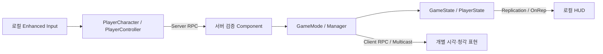

# 01. 아키텍처 — 서버 상태와 클라이언트 표현의 분리

## 설계 배경

Don't Melt는 2~4명이 Listen Server에서 경쟁하는 게임이다. 유물 소유권, 공격 결과, 경기 종료처럼 결과를 바꾸는 처리는 클라이언트가 결정하지 않는다. 반대로 HUD, 시점 전환, 이펙트는 로컬에서 처리한다.

핵심은 `HasAuthority()`를 부르는 것이 아니라 **어느 클래스가 어떤 데이터의 원본인가**를 먼저 정하는 데 있다. 이 게임은 상대의 정체를 숨기는 심리전이라, "HUD에 안 보이게 한다"와 "애초에 보내지 않는다"를 구분해야 했다.

## 클래스별 책임

| 계층 | 클래스 | 담당 |
|---|---|---|
| 로컬 전역 | `UDMGameInstance`, `UDMLocalSettingsSubsystem` | 맵 전환을 넘는 결과 캐시, 접속 실패 복구, 설정 저장 |
| Steam 세션 | `UDMOnlineSessionSubsystem` | 세션 생성·검색·참가·해제, 로비 광고 상태 |
| 로비 서버 | `ADMLobbyGameMode` | 호스트 지정, Ready 검증, 시작 잠금, 경기 이동 |
| 로비 공개 상태 | `ADMLobbyGameState`, `ADMLobbyPlayerState` | 인원 제한, 호스트·Ready 복제 |
| 경기 서버 | `ADMMatchGameMode` | 시작 인원 확정, Phase 전환, 사망 확정, 결과 작성, 결과 이동 |
| 경기 서버 보조 | `UDMRespawnCoordinator`, `DMMatchResultRules` | 리스폰 수명주기, 승패 규칙 계산 |
| 경기 공개 상태 | `ADMMatchGameState` | Phase와 종료 시각, 공개 퀘스트·이벤트, 결과 구조체 |
| 플레이어 상태 | `ADMMatchPlayerState` | 생존 상태, BaseSlot, 리매치 준비, 스킬 컴포넌트 |
| 플레이어 실행 | `ADMPlayerCharacter`, `UDM*Component` | 입력, 이동, 공격, 상호작용, 연출 |
| 서버 규칙 모듈 | `ADMRelicManager`, `UDMQuestDirector`, `UDMRandomEventDirector`, `UDMNPCPopulationDirector` | 시스템별 판정·진행·수명 관리 |
| 로컬 표현 | `UDMGameRootWidget`, `UDMSpectatorPresentationComponent` | 변경 알림을 UI·카메라에 반영 |

`ADMRelicManager`와 NPC·퀘스트·이벤트 Director는 GameMode가 구동하는 **서버 전용** 시스템이다. 유물 개수나 퀘스트 메시지를 표시하려고 매니저 전체를 클라이언트에 복제하지 않는다. 필요한 값만 GameState나 소유자 전용 복제로 공개한다.

GameMode와 PlayerController가 커지면서 리스폰·관전·승패 규칙을 분리한 과정은 [책임 분리 리팩토링](../Refactoring/01_Match_Responsibility_Split.md)에 정리했다.

## 데이터 흐름



서버 상태 갱신과 클라이언트 표현은 다른 경로로 움직인다. 예를 들어 경기 Phase는 GameState로 복제하고, 사망 후 카메라 전환은 소유자 PlayerController의 Client RPC로 시작한다.

## 구현 원칙

- 최종 결과는 GameMode만 확정한다. `ADMMatchGameState::TrySetMatchResult`는 이미 기록된 결과를 다시 확정하지 않는다.
- Listen Server의 호스트는 OnRep을 받지 않는다. 서버에서 값을 바꾼 직후 Delegate를 직접 호출해 호스트 화면도 갱신한다.
- `UDMGameInstance`는 경기 판정의 원본이 아니다. 맵 이동 중 결과 전달을 위한 캐시와 장애 복구만 맡는다.
- 입력·애니메이션·HUD는 다른 시스템의 상태를 따로 저장하지 않고, 실제 소유 컴포넌트를 읽는다.
- 동시에 성립할 수 있는 상태(이동·행동·생존·상태 효과)는 서로 다른 축으로 둔다. `CharacterMovement`가 이동을, `UDMCharacterStateComponent`가 ActionState와 상태 효과 태그를, PlayerState가 LifeState를 소유한다.

## 관련 코드

- [DMMatchGameMode.cpp](../../Source/DontMelt/Private/Framework/Match/DMMatchGameMode.cpp) — `EvaluateMatchResult`, `TryFinishMatch`
- [DMMatchGameState.cpp](../../Source/DontMelt/Private/Framework/Match/DMMatchGameState.cpp) — `TrySetMatchResult`, `GetLifetimeReplicatedProps`
- [DMGameInstance.cpp](../../Source/DontMelt/Private/Core/DMGameInstance.cpp) — `CacheFinalMatchResult`
- [DMRelicManager.cpp](../../Source/DontMelt/Private/Relic/DMRelicManager.cpp) — 생성자 (Tick·복제 비활성화)
- [DMGameRootWidget.cpp](../../Source/DontMelt/Private/UI/DMGameRootWidget.cpp) — `NativeConstruct`

## 핵심 코드

```cpp
void ADMMatchGameState::GetLifetimeReplicatedProps(TArray<FLifetimeProperty>& OutLifetimeProps) const
{
    Super::GetLifetimeReplicatedProps(OutLifetimeProps);

    DOREPLIFETIME(ADMMatchGameState, PhaseState);
    DOREPLIFETIME(ADMMatchGameState, StartingPlayerCount);
    DOREPLIFETIME(ADMMatchGameState, RequiredRelicCount);
    DOREPLIFETIME(ADMMatchGameState, MatchResult);
    DOREPLIFETIME(ADMMatchGameState, QuestPublicState);
    DOREPLIFETIME(ADMMatchGameState, RandomEventPublicState);
    DOREPLIFETIME(ADMMatchGameState, RelicRevealState);

    // 연장전 진입 시에만 채워지는 진영별 등록 유물 개수.
    DOREPLIFETIME(ADMMatchGameState, OvertimeIntroState);
}
```

GameState에는 **모두가 알아도 되는 값**만 있다. 진영별 등록 유물 수(`OvertimeIntroState`)는 연장전 소개 5초 동안만 채워지고, 평소에는 비어 있다.

---

[Technical 목차](README.md)
