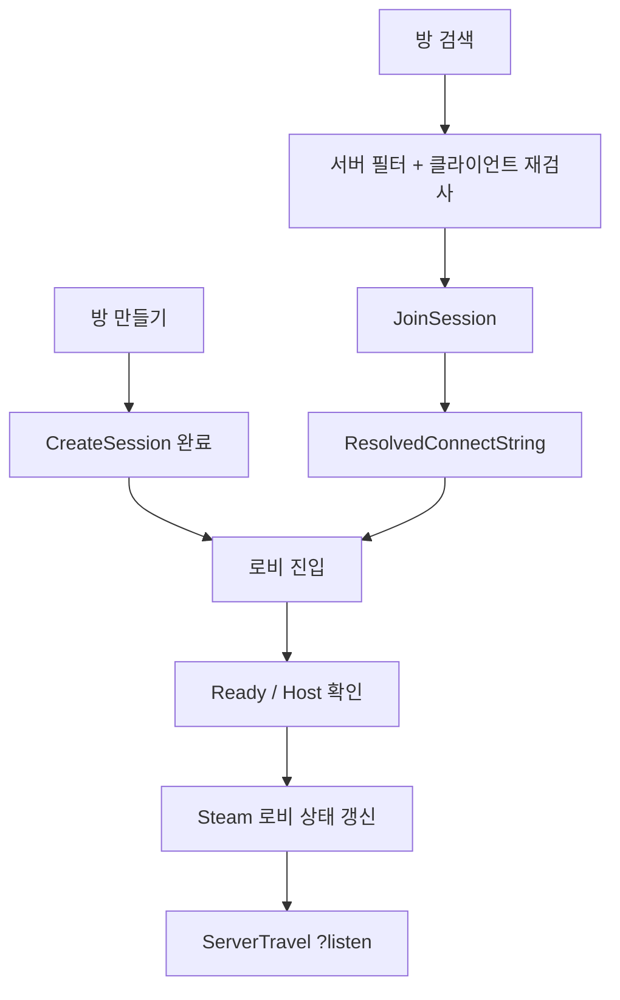

# 02. Steam 세션과 로비 — 비동기 작업과 이동 제어

## 해결하려는 문제

Steam 기반 Listen Server에서는 "방을 만들었다"와 "클라이언트가 서버 맵에 접속했다"가 다른 사실이다. 세션 생성·검색·참가를 비동기 작업으로 나누고, **로비 필터 → 접속 주소 확보 → 로비 준비 검증 → 서버 이동**을 단계별로 연결했다. 각 단계는 실패할 수 있으므로, 실패마다 상태를 되돌리는 경로를 두는 것이 이 시스템의 핵심이다.

## 세션 흐름

`UDMOnlineSessionSubsystem`(`UGameInstanceSubsystem`)이 `CreateLobbySession`, `FindLobbySessions`, `JoinLobbySession`, `DestroyLobbySession`, `UpdateLobbyMatchStarting`을 제공한다.



| 단계 | 처리 |
|---|---|
| 생성 | `bIsDedicated=false`, `bUsesPresence=true`, `bUseLobbiesIfAvailable=true`, 공개 연결 수 = 최대 인원. 프로젝트·로비 상태·네트워크 빌드 키를 `ViaOnlineService`로 광고 |
| 검색 | `SEARCH_LOBBIES`와 함께 프로젝트·로비 상태 키를 **Steam 서버 쪽 필터**로 걸고, 받은 결과를 `IsCompatibleOpenLobby`로 다시 검사 |
| 참가 | 검색 결과의 Presence·Lobby 플래그를 맞춘 뒤 `JoinSession` |
| 주소 | NamedSession에서 먼저 얻고, 실패하면 검색 원본으로 다시 시도 |
| 작업 제어 | `CurrentOperation`으로 작업 중첩을 막고, 작업마다 30초 타임아웃 |

## 실패 대응

| 실패 | 처리 | 문서 |
|---|---|---|
| 참가 후 접속 실패로 세션이 남음 | 메인 메뉴 진입·복구 완료·Host/Join 직전에 남은 세션 정리 | [잔여 세션](../Debugging/Network/02_Steam_Stale_Session.md) |
| 공유 AppID 480에서 결과 상한에 밀림 | 서버 쪽 필터 | [검색 필터](../Debugging/Network/03_Steam_Lobby_Search_Filter.md) |
| Steam 콜백이 오지 않음 | GameInstance 타이머로 30초 타임아웃, 늦은 콜백은 Delegate 해제로 무시 | [타임아웃](../Debugging/Network/04_Steam_Session_Timeout.md) |
| Presence·Lobby 불일치, 주소 해석 실패 | 참가 직전 정규화, 주소 2단계 해석 | [참가 단계 분리](../Debugging/Network/01_Steam_Join_Stages.md) |

## 로비 권한 검증

- `ADMLobbyPlayerController`는 Ready와 시작 요청을 Server RPC로 보낸다.
- `ADMLobbyGameMode::CanStartMatch`가 인원 제한, 호스트 수, 전원 Ready, 경기 맵 설정을 확인한다.
- 시작하면 `bTravelCommitted` 잠금을 걸고 Steam 로비 상태를 "시작 중"으로 바꾼 뒤 `?listen?ExpectedPlayers=N` URL로 이동한다.
- 경기 맵의 `ADMMatchGameMode::PreLogin`은 Steam 승인 명단, 중복 입장, 시작 인원 잠금을 검사한다.
- 로비 상태 갱신이나 이동이 실패하면 광고 상태를 되돌리고 잠금을 푼다. 실패 분기마다 해제 경로를 둔 과정은 [로비 시작 잠금](../Refactoring/02_Lobby_StartLock.md)에 정리했다.
- 경기 후 돌아온 로비는 참가자 복귀가 끝나기 전 새 시작을 막고, 30초가 지나면 도착한 인원 기준으로 다시 연다.

## 관련 코드

- [DMOnlineSessionSubsystem.cpp](../../Source/DontMelt/Private/Online/DMOnlineSessionSubsystem.cpp) — `CreateLobbySession`, `FindLobbySessions`, `JoinLobbySession`, `HandleJoinComplete`, `StartOperationTimeout`
- [DMFrontendPlayerController.cpp](../../Source/DontMelt/Private/Framework/Frontend/DMFrontendPlayerController.cpp) — `CleanupStaleLobbySession`
- [DMLobbyGameMode.cpp](../../Source/DontMelt/Private/Framework/Lobby/DMLobbyGameMode.cpp) — `CanStartMatch`, `CommitMatchTravel`, `ReleaseMatchStartLock`
- [DMMatchGameMode.cpp](../../Source/DontMelt/Private/Framework/Match/DMMatchGameMode.cpp) — `PreLogin`

## 핵심 코드

```cpp
FOnlineSessionSettings Settings;

Settings.bIsLANMatch = false;
Settings.bIsDedicated = false;
Settings.bShouldAdvertise = true;

// Listen Server와 Steam Lobby를 사용한다.
Settings.bUsesPresence = true;
Settings.bUseLobbiesIfAvailable = true;

// 로비에서는 참가를 허용한다. 경기 시작 시 변경한다.
Settings.bAllowJoinInProgress = true;
Settings.bAllowJoinViaPresence = true;

Settings.NumPublicConnections = MaxPlayers;
Settings.NumPrivateConnections = 0;
```

```cpp
SessionSearch->QuerySettings.Set(SEARCH_LOBBIES, true, EOnlineComparisonOp::Equals);

// 공유 App ID(480)에서는 다른 게임 로비가 결과 상한을 채울 수 있으므로
// Steam 서버 쪽에서 프로젝트와 로비 상태로 먼저 거른다.
SessionSearch->QuerySettings.Set(DMProjectKey, DMProjectValue, EOnlineComparisonOp::Equals);
SessionSearch->QuerySettings.Set(DMLobbyStatusKey, DMLobbyOpenValue, EOnlineComparisonOp::Equals);
```

---

[Technical 목차](README.md)
