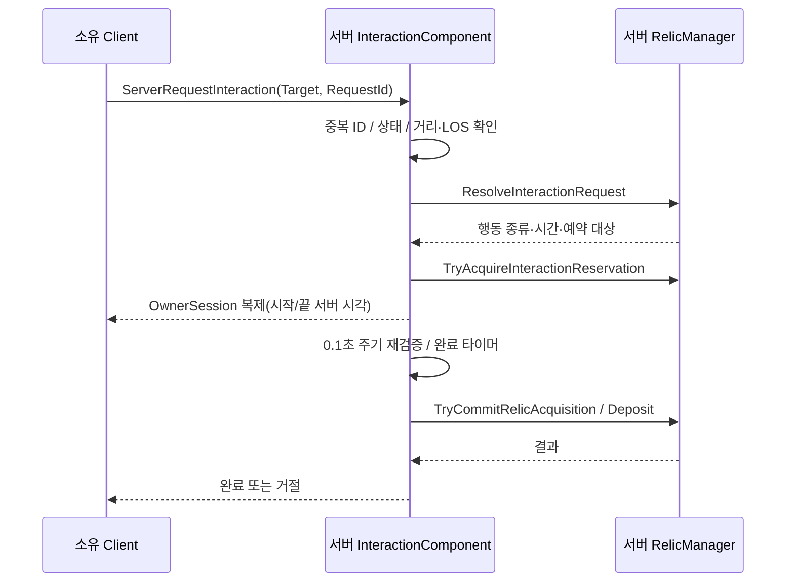

# 06. 유물 시스템 — 서버 검증형 상호작용과 예약

## 해결하려는 문제

유물 줍기·상자 등록·훔치기를 클라이언트 입력만으로 확정하면 거리 조작, 두 명의 동시 획득, 진행 중 대상 변경으로 결과가 충돌한다. 그래서 역할을 둘로 나눴다.

- `UDMInteractionComponent`: 요청을 받고 진행 세션을 관리한다.
- `ADMRelicManager`: 유물 소유권과 등록 상태의 원본을 갖고, 예약과 최종 Commit을 맡는다.

## 요청부터 Commit까지



| 단계 | 처리 |
|---|---|
| 요청 | `RequestId`가 이전 값 이하이면 거절. 재전송·과거 요청 재사용을 막는다 |
| 예약 | 유물 하나를 한 명만 예약할 수 있다. 두 명이 동시에 주우려 하면 먼저 예약한 쪽만 진행한다 |
| 진행 | 서버가 0.1초마다 같은 상호작용 종류·예약 유효성·거리·시야를 다시 검사한다 |
| Commit 직전 | 대상과 조건을 다시 확인한다. 예약 성공이 완료를 보장하지 않는다 |
| 종료 | 성공·실패·취소 모두 예약과 이동 제한을 해제한다 |

진행바는 서버가 시작·종료 서버 시각을 소유자에게만 복제하고, 클라이언트가 그 시각으로 그린다. 진행 중 매 프레임 값을 보내지 않는다.

## 상태 원본

| 객체 | 역할 |
|---|---|
| `ADMRelic` | 복제되는 개별 유물. `WorldState`(PublicSpawn / Carried / Dropped / DepositProtected / Registered)와 등록 BaseSlot |
| `ADMRelicChest` | 진영 상자. 상호작용 지점이며 등록 수를 따로 저장하지 않는다 |
| `ADMBaseZone` | 진영 활성 상태 |
| `ADMRelicManager` | 서버 전용. 초기 배치, 운반자 관계, 등록 수 계산, 획득·등록·드롭 트랜잭션, 위치 복구, 예약 |
| `ADMMatchPlayerState::bIsCarryingRelic` | 소유자 HUD용 표시값. 실제 운반 관계의 원본은 Manager |

등록 수는 캐시로 누적하지 않고 유물 상태에서 계산한다. 원본이 하나라 상자·GameState·HUD가 서로 다른 값을 가질 수 없다.

## 실패와 취소

- **실패**(거리 이탈, 시야 차단)와 **시스템 취소**(Phase 변경)를 구분한다. 등록 실패에는 Drop 페널티가 있으므로, 플레이어 잘못이 아닌 취소에는 페널티를 주지 않는다. → [Phase 변경 문제](../Debugging/Gameplay/04_Interaction_PhaseChange.md)
- 시야 판정은 사이를 지나가는 Pawn을 차단으로 보지 않는다. → [LOS 문제](../Debugging/Gameplay/03_Interaction_LOS_Pawn.md)
- 수동 드롭은 줍기와 같은 Visibility 채널로 전방을 검사해 벽 앞에 놓는다. → [벽 앞 드롭](../Debugging/Gameplay/05_Relic_Drop_Wall.md)
- 등록 직후 5초는 보호 상태라 훔칠 수 없다. 보호 중인 유물도 등록 수에 포함한다.
- 바닥이 없는 위치에 떨어진 유물은 1초 주기 검사로 지정된 복구 지점으로 옮긴다.

## 관련 코드

- [DMInteractionComponent.cpp](../../Source/DontMelt/Private/Characters/Components/DMInteractionComponent.cpp) — `ServerRequestInteraction_Implementation`, `ServerValidateActiveInteraction`, `BeginServerInteraction`, `HasServerLineOfSightTo`
- [DMRelicManager.cpp](../../Source/DontMelt/Private/Relic/DMRelicManager.cpp) — `ResolveInteractionRequest`, `TryAcquireInteractionReservation`, `TryCommitRelicAcquisition`, `TryCommitRelicDeposit`, `TryDropCarriedRelic`

## 핵심 코드

```cpp
// 같은 Request 또는 과거 Request의 재사용 방지.
if (RequestId <= 0 || RequestId <= LastServerProcessedRequestId)
{
    UE_LOG(LogDMInteraction, Verbose,
        TEXT("Interaction request rejected: duplicate or stale RequestId. IncomingRequestId=%d, LastProcessedRequestId=%d, Owner=%s"),
        RequestId, LastServerProcessedRequestId, *GetNameSafe(OwnerCharacter));

    ClientRejectInteraction(RequestId);
    return;
}
```

---

[Technical 목차](README.md)
