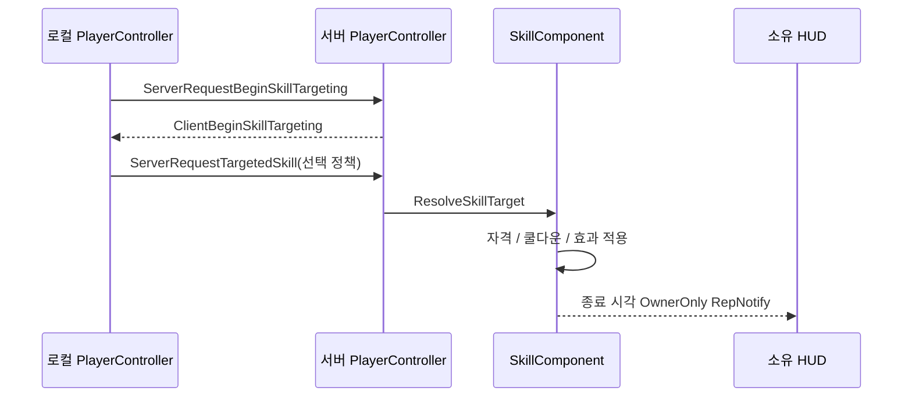

# 10. 스킬 — 서버가 고르는 대상과 종료 시각 복제

## 설계 목표

스킬은 플레이어가 대상을 고르는 것처럼 보이지만, **실제 대상은 서버가 정한다.** 클라이언트가 상대 PlayerState를 직접 보내면 승패에 유리한 대상을 마음대로 고를 수 있고, 상대의 정체도 드러난다. 그래서 클라이언트는 **선택 정책**만 보낸다.

쿨다운은 HUD가 매번 서버에 묻지 않도록 스킬별 **종료 서버 시각**을 소유자에게만 복제한다.

## 처리 경로



`UDMSkillComponent`는 `ADMMatchPlayerState`가 소유한다. 쿨다운은 Pawn이 죽거나 바뀌어도 유지돼야 하기 때문이다. `InitializeSkillSystem`이 서버에서 스킬 정의를 검증하고, `GetSkillAvailability`가 사용 가능 상태를 계산한다.

## 대상 선정

| 정책 | 입력 | 서버 처리 |
|---|---|---|
| `RandomEligible` | LMB | 자격 있는 후보 중 무작위 1명 |
| `LeadingEligible` | RMB | `ADMRelicManager`의 등록 유물 수가 가장 많은 후보, 동률이면 그중 무작위 |

후보는 플레이어만 허용하고 NPC, 자기 자신, 사망자, 스폰 보호 중인 대상을 뺀다. 거리와 시야 제한은 두지 않는다. 후보가 없으면 대상 선택을 끝내고 쿨다운을 소비하지 않는다. 사용 실패와 취소도 쿨다운을 소비하지 않는다.

## 구현한 스킬

| 스킬 | 쿨다운 | 지속 | 처리 |
|---|---:|---:|---|
| 투명화 | 25초 | 5초 | 서버가 `Status.Invisible` 적용. Actor는 그대로 두고 Mesh 가시성만 숨긴다. 관찰자에게는 표현용 bool로 전달. 공격을 시도하면 서버가 해제 |
| 발소리 증폭 | 60초 | 8초 | 공통 발소리 파이프라인을 써서 시전자에게만 대상의 발소리를 크게 들려준다. 대상에게 새 상태 태그를 붙이지 않는다 |
| 시야 교란 | 600초 | 주효과 5초 | 서버가 승인하고 대상 클라이언트의 PostProcess에서 재생 (진입 0.75초 + 주효과 5초 + 해제 0.5초) |

사망·관전·리스폰 중에도 쿨다운은 계속 흐른다. 효과 종료·사망·경기 종료 때는 일시 효과와 로컬 화면 효과를 별도 함수로 정리한다.

## 관련 코드

- [DMMatchPlayerState.cpp](../../Source/DontMelt/Private/Framework/Match/DMMatchPlayerState.cpp) — SkillComponent 생성
- [DMSkillComponent.cpp](../../Source/DontMelt/Private/Skills/DMSkillComponent.cpp) — `InitializeSkillSystem`, `ResolveSkillTarget`, `GetSkillAvailability`, `StartSkillCooldown`, `TryExecuteInvisibility`, `TryExecuteFootstepAmplify`, `TryExecuteVisionDistort`
- [DMMatchPlayerController.cpp](../../Source/DontMelt/Private/Framework/Match/DMMatchPlayerController.cpp) — `ServerRequestTargetedSkill_Implementation`

## 핵심 코드

```cpp
TArray<ADMMatchPlayerState*> EligibleTargets;

GatherEligibleTargetsForSkill(SkillTag, EligibleTargets);

if (EligibleTargets.IsEmpty())
{
    return nullptr;
}

switch (TargetMode)
{
case EDMSkillTargetMode::RandomEligible:
{
    const int32 RandomIndex = FMath::RandRange(0, EligibleTargets.Num() - 1);

    return EligibleTargets[RandomIndex];
}
// LeadingEligible: 등록 유물 수 최댓값 후보 중 무작위
```

---

[Technical 목차](README.md)
