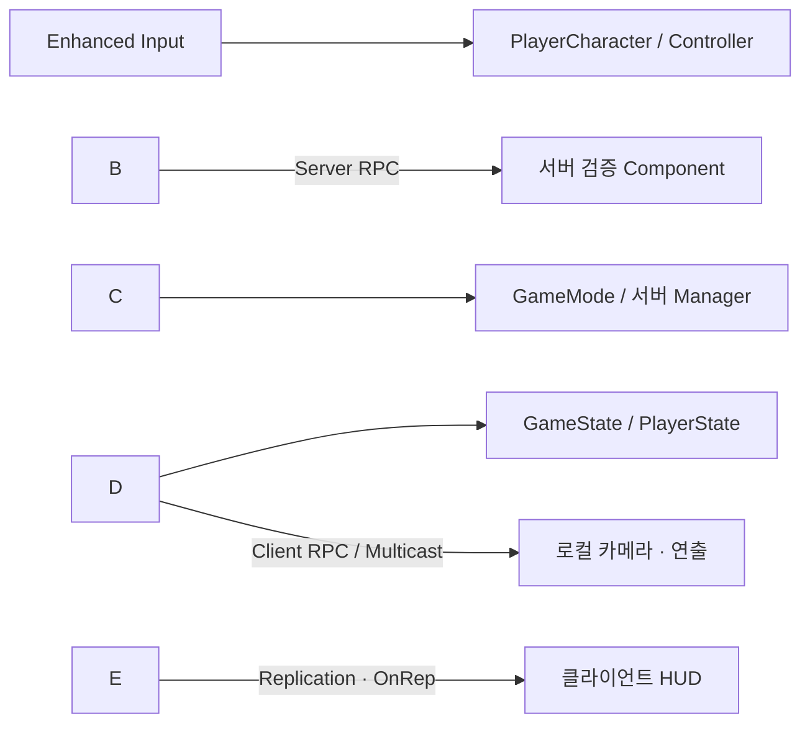

# Don't Melt

**NPC 군중 속에 섞여 정체를 숨기고, 유물을 차지하는 2\~4인 온라인 심리전 게임**

Unreal Engine 5.5와 C++로 개발한 개인 프로젝트입니다. 

플레이어와 NPC는 같은 젤리 캐릭터를 사용하며, 참가자는 움직임·행동·발소리·음성을 단서로 서로를 구별합니다. 

상대에게 정체를 들키지 않으면서 유물을 자기 상자에 등록하고, 다른 플레이어의 유물을 빼앗을 수도 있습니다.


이 프로젝트에서 중점적으로 다룬 것은 **서버 권한 기반 게임 규칙, 정보 노출을 고려한 네트워크 동기화, 비동기 접속·맵 이동의 실패 복구, 다수 NPC의 실행 비용**입니다.


## 프로젝트 개요

|항목|내용|
|-|-|
|개발 형태|개인 프로젝트|
|개발 환경|Unreal Engine 5.5 · C++ · Blueprint(에셋·UI·연출 연결)|
|멀티플레이|2\~4인 Listen Server · Steam OnlineSubsystem|
|게임 유형|NPC 위장 · 유물 쟁탈 · 개인전 · 심리전|
|경기 구성|정규 15분 · 최대 3분 연장전 · 사망 후 30초 리스폰|
|NPC 구성|참가자당 15명, 4인 경기 기준 최대 60명|
|주요 기술|Gameplay Framework · Replication/RPC · Enhanced Input · UMG · Steam Voice · AnimInstance|

게임 중 상대의 이름이나 유물 보유량을 상시 표시하지 않습니다. **UI에서 정보를 감추는 것과 네트워크로 해당 정보를 전송하지 않는 것은 다르다**는 점을 설계 기준으로 삼았습니다.

[게임 기획서](Docs/Design/GameDesign.md) · [시스템 아키텍처](Docs/Design/SystemArchitecture.md) · [전체 기술 문서](Docs/Technical/README.md)


## 핵심 구현

|영역|구현 내용|상세 문서|
|-|-|-|
|**서버 권한·데이터 소유권**|`GameMode`의 경기 판정, `GameState`의 공개 상태, `PlayerState`의 지속 데이터 분리. 서버 전용 유물 정보와 소유자 전용 복제 구분|[아키텍처](Docs/Technical/01_Architecture.md) · [Replication/RPC](Docs/Technical/04_Replication_RPC.md)|
|**Steam 세션·로비**|세션 생성·검색·참가, Ready 검증, ServerTravel, 비동기 실패·타임아웃·잔여 세션 복구|[세션·로비](Docs/Technical/02_Steam_Session_Lobby.md)|
|**유물·상호작용**|RequestId, 유물 예약, 진행 중 거리·시야 재검증, 완료 직전 Commit 검사로 중복 처리와 경합 방지|[유물 시스템](Docs/Technical/06_Relic_Interaction.md)|
|**이동·전투·스킬**|`FSavedMove` 기반 Sprint 예측, 클라이언트 선재생과 서버 타격 판정 분리, 서버 쿨다운·대상 확정|[이동](Docs/Technical/05_Input_Movement.md) · [전투](Docs/Technical/07_Combat_Death.md) · [스킬](Docs/Technical/10_Skill_Cooldown_Target.md)|
|**NPC·젤리 애니메이션**|플레이어와 동일한 캐릭터 기반 클래스, 서버 타이머 AI, 감쇠 스프링 기반 본 변형, 사망 시에만 Ragdoll 전환|[NPC AI](Docs/Technical/08_NPC_AI.md) · [젤리 애니메이션](Docs/Technical/12_Jelly_Animation_Ragdoll.md)|
|**UI·관전·음성**|Root Widget 레이어, Pawn 교체 시 바인딩 갱신, 사망 관전, 생존 시 근접 음성·사망 시 전역 청취 정책|[UMG](Docs/Technical/11_UMG_UI.md) · [관전](Docs/Technical/13_Spectator_Respawn.md) · [음성](Docs/Technical/14_Voice_Chat.md)|

## 

## 주요 문제 해결 사례

단순히 오류를 수정하는 데서 끝내지 않고, **재현 → 실패 단계 또는 상태 소유자 확인 → 원인 추적 → 대안 비교 → 회귀 조건 정리** 순서로 기록했습니다.

|문제|분석과 해결의 핵심|기록|
|-|-|-|
|방 검색은 되지만 참가가 실패함|OSS 초기화부터 ConnectString·NetDriver까지 접속 단계를 분리하고, 실패 후 남은 세션까지 정리|[참가 단계별 추적](Docs/Debugging/Network/01_Steam_Join_Stages.md) · [잔여 세션](Docs/Debugging/Network/02_Steam_Stale_Session.md)|
|결과가 보관되기 전에 로비로 이동함|서로 다른 Actor의 복제·RPC 도착 순서에 의존하지 않고 **결과 캐시 완료 후 ResultId 기반 ACK**로 이동 제어|[결과 동기화 경합](Docs/Debugging/Network/07_MatchResult_Travel_Race.md)|
|멀리서 투명화한 플레이어가 상대에게 보임|순간적인 Multicast와 뒤늦게 Relevant해진 연결의 차이를 확인하고 **지속 상태를 RepNotify**로 관리|[투명화 Relevancy](Docs/Debugging/Gameplay/01_Invisibility_Relevancy.md)|
|상호작용 시야 판정 수정안이 다른 충돌을 유발할 수 있음|트레이스 종류별 충돌 응답 차이를 비교해, 기존 규칙을 훼손하는 1차 수정안을 반영 전에 폐기|[상호작용 LOS](Docs/Debugging/Gameplay/03_Interaction_LOS_Pawn.md)|

→ [전체 디버깅 기록](Docs/Debugging/README.md) · [책임 분리·리팩토링](Docs/Refactoring/README.md)

## 

## 아키텍처



* **GameMode:** 경기 단계, 사망 확정, 승패 판정 및 이동 제어
* **GameState:** 모든 플레이어에게 공개할 경기 단계·시간·결과
* **PlayerState:** Pawn 교체 후에도 유지할 생존 상태·스킬 등 플레이어 데이터
* **서버 전용 Manager/Director:** 유물 소유권, NPC 인구, 퀘스트·랜덤 이벤트 관리
* **PlayerController·UMG:** 로컬 입력·화면 표현 및 데이터 변경 알림 처리

기능을 추가하며 비대해진 GameMode와 PlayerController에서는 리스폰 수명주기, 관전 연출, 승패 계산을 각각 분리했습니다. 승패 규칙은 월드에 의존하지 않는 순수 함수로 정리했습니다.

[책임 분리 과정](Docs/Refactoring/01_Match_Responsibility_Split.md) · [경기 흐름과 결과](Docs/Technical/03_Match_Flow_Result.md)

## 

## 성능 분석과 검증

* **비용 관리:** NPC 행동은 타이머·완료 콜백 중심으로 구성하고, 지속적인 젤리 움직임은 AnimInstance에서 계산합니다. 물리 Ragdoll은 사망 표현에 한정합니다.
* **프로파일링:** NPC **40명** 환경에서 AI와 CharacterMovement 비용을 구분해 측정했습니다. 이후 최대 **60명** 구성의 최종 성능 확인은 별도 측정 시나리오로 정리했습니다. 계획한 최적화를 이미 적용했거나 효과가 검증된 것으로 표시하지 않습니다.
* **회귀 검증:** PIE 다중 클라이언트, Steam 패키지 접속, 네트워크 지연·손실, 매치 결과, 관전·리스폰, UI 입력 복구 등의 확인 항목을 관리합니다.

[NPC 성능 분석](Docs/Performance/01_NPC_Performance_Analysis.md) · [프로파일링 계획](Docs/Performance/03_Profiling_Plan.md) · [검증 시나리오](Docs/Verification/03_Regression_Scenarios.md)

## 

## 문서 안내

|문서|내용|
|-|-|
|[Design](Docs/Design/README.md)|게임 규칙, 시스템 아키텍처, UI·입력 및 단계별 설계|
|[Technical](Docs/Technical/README.md)|시스템별 C++ 구조, 주요 함수와 데이터 흐름|
|[Debugging](Docs/Debugging/README.md)|네트워크·게임플레이·UI·빌드 문제 해결 과정|
|[Refactoring](Docs/Refactoring/README.md)|책임 분리, 데이터 의미 정리, 실패 경로 개선|
|[Performance](Docs/Performance/README.md)|NPC 측정, 실행 비용 관리, 추가 프로파일링 계획|
|[Verification](Docs/Verification/README.md)|정적 검수 방법, 패키징 확인 사항, 회귀 테스트|
|[DevLog](DevLog/README.md)|개발 단계별 기록과 Unreal C++ 학습 노트|

### 

### 폴더 구조

```text
DontMelt/
├── README.md
├── Docs/
│   ├── Design/
│   ├── Technical/
│   ├── Debugging/
│   ├── Refactoring/
│   ├── Performance/
│   └── Verification/
├── DevLog/
│   ├── step00\_Planning.md ... step11\_Steam\_Voice\_Jelly.md
│   └── Study/
└── Media/
```

기술 문서에 있는 C++ 파일 링크는 저장소 루트의 `Source/DontMelt/` 경로를 기준으로 작성했습니다.

